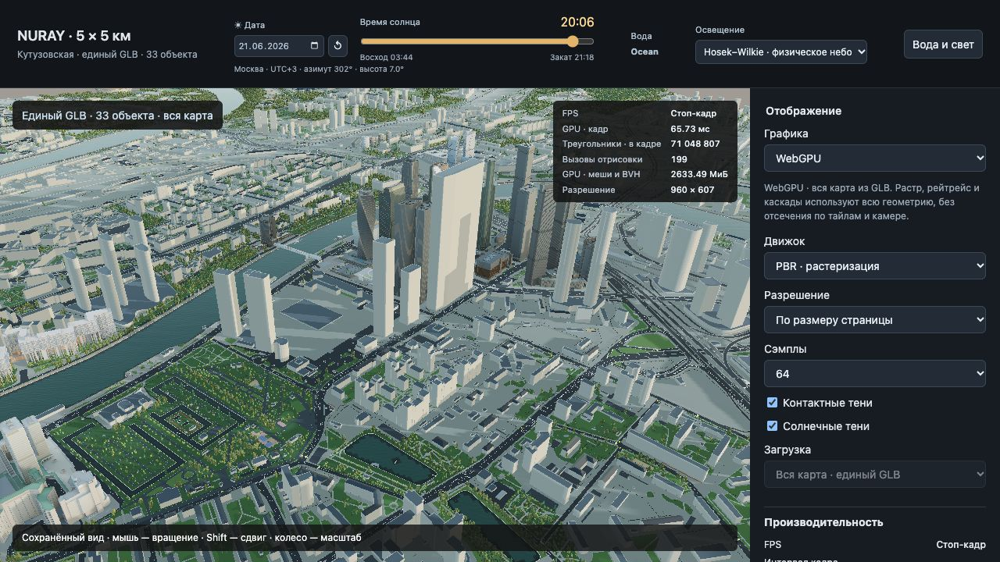

# NURAY — городской макет и экспериментальный рендерер

Проект «Найти интересные идеи рендеринга»: алгоритмическая геометрия города из данных 2ГИС, собственные WebGPU/WebGL2 рендереры, PBR-растеризация и WebGPU-трассировка лучей.

**Актуальная кодовая база находится в `moscow-fidelity/`.** Старые корневые `src/` и прототипы сохранены для истории; GitHub Pages публикует `moscow-fidelity/web-preview/`.

- [Открыть viewer](https://niemandx.github.io/NURAY/)
- [База знаний и видение проекта](docs/knowledge/README.md)
- [Продолжить работу на другом компьютере](docs/knowledge/HANDOFF.md)
- [Архитектура и сборка](docs/knowledge/ARCHITECTURE.md)
- [Принятые визуальные решения](docs/knowledge/DECISIONS.md)
- [Размещение данных и публикация](docs/knowledge/DEPLOYMENT.md)
- [Московский пресет от 27 октября 2026](docs/moscow-approved-20261027.json)
- [Размеры и SHA-256 файлов сцены](docs/assets-manifest.json)

Москва: 5 × 5 км, выпуск `assets-moscow-style-20261024-r14`. По умолчанию — WebGPU, растеризация, физическое небо Hosek–Wilkie, Ocean, сохранённый ракурс и свет. Настройки Петербурга не заменяются московскими.

Код, небольшие библиотечные ассеты и документация — здесь. Сшитый GLB, тайлы, текстуры сцены и ускорители трассировки — в Object Storage Cloud.ru, бакет `nuray-scenes`. Секреты доступа в репозиторий не входят.

## Быстрый запуск

```sh
git clone https://github.com/NieMandX/NURAY.git
cd NURAY
python3 -m http.server 8776 --bind 127.0.0.1 --directory moscow-fidelity/web-preview
```

Открыть <http://127.0.0.1:8776/>. По умолчанию данные загружаются из Cloud.ru. Не открывайте `index.html` через `file://`: ES-модулям нужен HTTP.

Для локальной копии данных:

```sh
python3 scripts/restore_assets.py --mode merged
```

Полный набор с тайлами: `--mode all`. Затем уберите `assetBase` из локального `moscow-fidelity/web-preview/prototype/tiles/config.json`. Сборка геометрии для просмотра готовой сцены не требуется.


